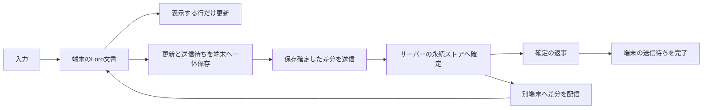

# 次の実装を絞るための判断

目標は一人が端末を持ち替えて続きを書けること。開くたびに同期方法を選ぶことや、
通常の追記でJSON退避を要求することは、製品の動作として採用しない。
検証室の結果と、本番採用の判断を分ける。

## 推薦する方向

アウトラインの次の試作は、**LoroTextとLoroTreeを一つの文書で使う構成**へ絞る。
文字と枝の並行変更を、既存の専用型へ任せられる点を重視する。
ただし現在のHTTP交換・毎回の全文保存・全行変換を、そのまま製品へ持ち込む推薦ではない。
1万行の起動と入力の負荷を解消してから、本番への実装判断へ進む。

Yjs案は本文の既存接続と応答性が有利だが、今回の親IDの木には、利用者が別々に行った合法な移動だけで
循環するケースがある。独自の木の統合・回復を今から作る方向は避ける。
PowerSync案はDBとの接続と端末内SQLiteを任せられるが、今回の列照合では同じ本文への別々の追記も
確認対象になる。本文統合・Undo・木の操作の意味を、独自APIと履歴へ作り込む負担が残る。
両案を一般に不適とする判断ではなく、今回のアウトラインとUXに対する選択である。

根拠となる実行記録は [RESULTS.md](RESULTS.md)、負荷と限界は [PERFORMANCE.md](PERFORMANCE.md)、
責任の分担は [OPERATIONS.md](OPERATIONS.md) に残す。Loroも意味が両立しない本文を自動判定する仕組みや、
削除済み親への古い移動を使いやすく表示する仕様は未完成であり、全UXを満たしたとは扱わない。

## 保存と同期の形

初回はサーバーに保存したsnapshotで速く復元し、以降は不足する更新だけを交換する。
保存済みの端末は手元のsnapshotと更新ログから表示し、並行して最新版を受け取る。
受信や再表示をローカル編集へ変換しない。起動時にJSONからCRDT履歴を作り直さない。

端末では毎入力の差分を追記し、定期的にsnapshotへまとめる。全文の作成を後回しにしても、
入力の確定と送信待ちの記録を別取引へ分けない。まとめ直しは保存済みの更新を欠かさず、
途中失敗しても以前の世代から復元できる形で行う。
サーバーも保存確定を返事の条件にし、通信の受領確認だけで送信待ちを捨てない。

通信は既存のLoro Protocol等を評価する。今回の100ms HTTPポーリングと、毎回ファイルから文書全体を
作り直すAPIを製品の基盤にしない。既存Protocolを使っても、認証と永続化の保証は別に検証する。
本文と木を別々のCRDTライブラリーへ分割して、二つの履歴の整合を新しく作る案も採らない。

## 次の作業をどこで区切るか

まず、検証室のLoro経路だけで次の二点を直す。認証や本体への移植は同時に広げない。

1. 初回のsnapshot配信と、その後の差分交換。再送、古い端末、未適用の受信更新を含めて履歴が欠けないこと。
2. 毎入力の全行変換と全文snapshotを外す。表示用データの更新と、端末の差分保存・まとめ直しを検証する。

同じ1万行の測定を再実行し、全行一致・圏外再起動・送信中の追加入力・保存失敗の試験を保ったまま
起動と入力が改善したところを次の区切りとする。速度の改善だけで、保全の条件を緩めない。
その後に既存Protocolの保存保証と複数窓、PWAの休止復帰を含む一つの製品向け縦経路を作る。

## 本番切替までの条件

- PC Chrome PWA・iPad PWA・Android PWAで、圏外起動、休止復帰、日本語変換と持ち替えをまとめて確認する。
- 保存拒否・容量不足・通信切断・サーバー再起動・同じ端末の複数窓で、内容と未送信の編集を保つ。
- 認証した本人の文書だけにアクセスでき、古い端末が再接続しても全体を上書きしない。
- 同じ範囲の両立できない変更は両案を局所的に保全し、他の行の入力や同期を止めない。
- 既存の一万行超、未送信内容、画像参照とDriveの控えを使って、戻せる移行手順を検証する。

利用者に実機の確認を頼むのは、検証室で再現・修正できる問題を片付けた後に一度にまとめる。
本番データを比較実験の入力や、繰り返しの手動復旧の材料として使わない。
